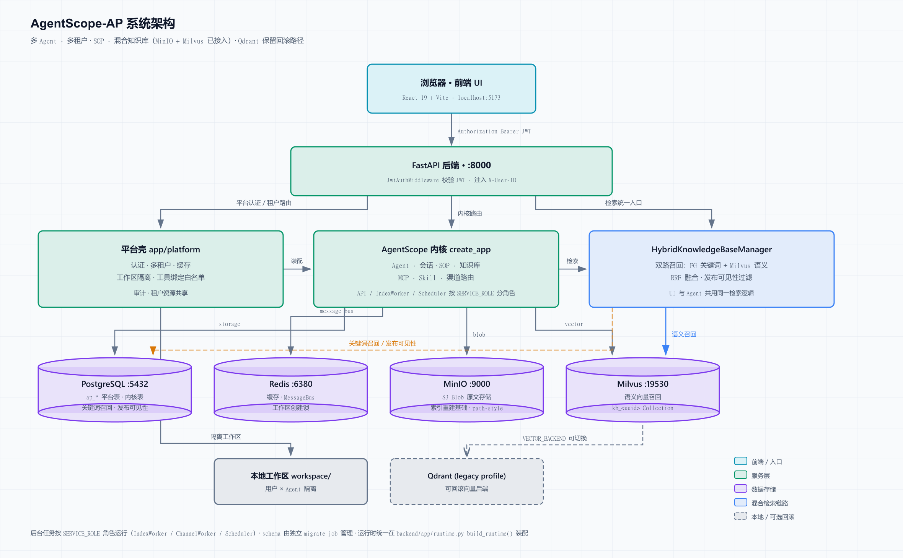

# AgentScope-AP

基于 AgentScope 2.0 的多 Agent 平台：多 Agent · 多 Skill · 多 MCP · 多用户/多租户 · 向量知识库，含前后端与缓存/分布式支持。

## 架构

<picture>
  <source media="(prefers-color-scheme: dark)" srcset="diagram/agentscope-ap-architecture/architecture@2x.png">
  
</picture>

- **内核**：AgentScope `create_app`（PyPI 正式包 `agentscope==2.0.12`），提供 Agent/会话/知识库/MCP/Skill/渠道全部路由。
- **平台壳** `backend/app/platform`：JWT 认证（注入 `X-User-ID`）、多租户资源访问策略、Redis 缓存、平台路由。
- **运行时装配** `backend/app/runtime.py`：storage=PostgreSQL、message_bus=Redis、blob=MinIO/S3（默认 `BLOB_BACKEND=s3`）、vector=Milvus（默认 `VECTOR_BACKEND=milvus`，Qdrant 可回滚）、workspace=本地（用户 × Agent 隔离）。
- **混合知识库**：PostgreSQL 关键词召回 + Milvus 语义召回 → RRF 融合 → 发布可见性过滤，UI 与 Agent 共用同一检索逻辑。
- **前端**：复用官方 `web_ui`（React 19 + Vite + shadcn + Tailwind），新增登录页与 `Authorization` 头。

## 快速启动

前置：Docker Desktop、Python 3.12+（uv）、Node + pnpm。

```powershell
# 1. 配置环境变量（至少填一个模型 API Key）
cp .env.example .env   # 然后编辑 .env

# 2. 一键启动（依赖 + 后端 + 前端）
./start.ps1
```

或分步：

```powershell
# 依赖（PostgreSQL/Redis/Milvus/MinIO；Qdrant 为 legacy 可选，默认不启动）
docker compose up -d postgres redis milvus minio minio-init

# 后端
cd backend; uv venv .venv; uv pip install --python .venv -e .
.venv/Scripts/python -m app.main

# 前端（另开终端）
cd frontend; pnpm install; pnpm dev
```

访问：前端 http://localhost:5173 ，后端文档 http://localhost:8000/docs 。
首次打开进入登录页，先「注册」一个账号（自动创建个人租户）即可进入。

## 端口约定

| 服务 | 端口 | 说明 |
|------|------|------|
| 前端 | 5173 | Vite dev |
| 后端 | 8000 | FastAPI |
| PostgreSQL | 5432 | 主库（平台表 + 内核表 + 关键词召回） |
| Redis | **6380** | 本机 6379 被 Windows 原生 Redis 占用，故映射 6380 |
| Milvus | 19530/9091 | 向量库（语义召回），依赖内置 etcd |
| MinIO | 9000/9001 | S3 兼容对象存储（API / 控制台） |
| Qdrant | 6333/6334 | 向量库（legacy profile，可回滚后端，默认不启动） |

## 当前状态

- ✅ 阶段1：单体后端（PG + RedisBus + 知识库 + 本地工作区）+ 官方前端。
- ✅ 阶段2：JWT 认证 + 多租户（`TenantResourceAccessPolicy`）+ 登录页 + Authorization 头。
- ✅ 阶段2 后续：服务级团队（explorer/coder 角色蓝图）+ Skill/MCP 市场（ClawHub / GitHub MCP Registry）。
- ✅ 阶段3：SOP 标准流程（步骤编排 + Agent/人工验收 + 失败重试 + 运行监控），自研前端三页面。
- ✅ 阶段3 后续：工作区「用户 × Agent」隔离 + Skill/MCP 按用户绑定白名单，含双用户真实浏览器验收。
- ✅ MinIO/S3 对象存储：`BLOB_BACKEND=s3` 默认接入，docker-compose 提供 MinIO 与桶/策略初始化；本地 Blob 保留为可切换后端。
- ✅ 混合知识库：MinIO 原文 + Milvus 语义召回 + PostgreSQL 关键词召回/发布可见性 + RRF 融合；Qdrant 保留回滚路径，索引重建/迁移/回滚脚本齐备。

## SOP 标准流程

内核 `sop_router` 默认挂载，前端自研三页面：

- `/sop`：流程列表 + 步骤概览 + 运行记录，一键启动运行。
- `/sop/new`、`/sop/:sopId/edit`：步骤编辑器（执行 Agent、目标描述、验收方式（无/人工/Agent）、最大重试次数、每会话模型配置）。
- `/sop/runs/:runId`：运行监控（3s 轮询、步骤状态、产出与验收记录、人工通过/打回、跳转对应会话）。

一键创建演示数据（演示 Agent ×2 +「软件研发标准流程」SOP，含人工验收节点）：

```powershell
cd backend
# 前提：后端已启动，且账号下已配置至少一个聊天模型凭证
.venv/Scripts/python scripts/seed_sop_demo.py
```

注意：真正执行 SOP 运行需要有效模型 API Key（在「凭证」页配置）；未配置时只能体验编排与 API，执行会在模型调用处失败。

## 注意

- 真正跑 Agent 对话前，需在 `.env` 填入至少一个模型 API Key（`DASHSCOPE_API_KEY` 等）。
- `AUTH_ENABLED=false` 可退回阶段1（无 token 透传 `X-User-ID`），便于本地联调。
